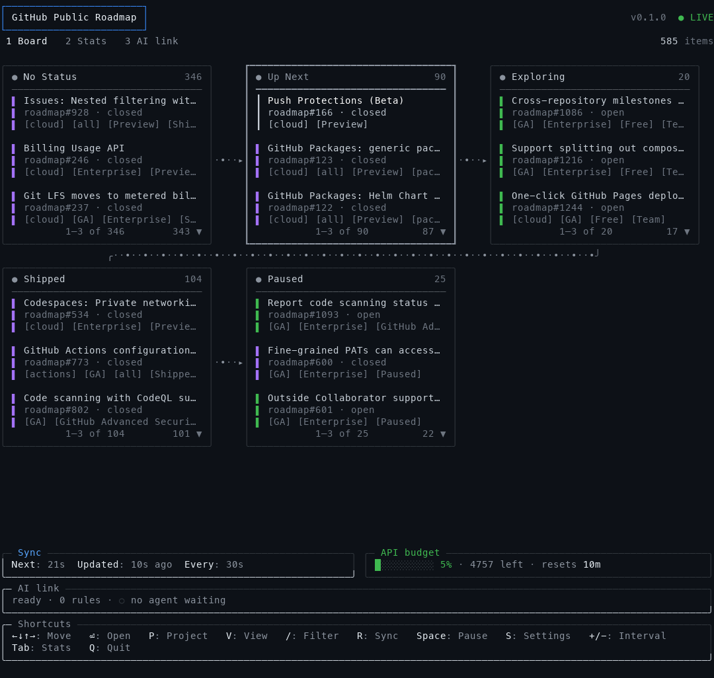
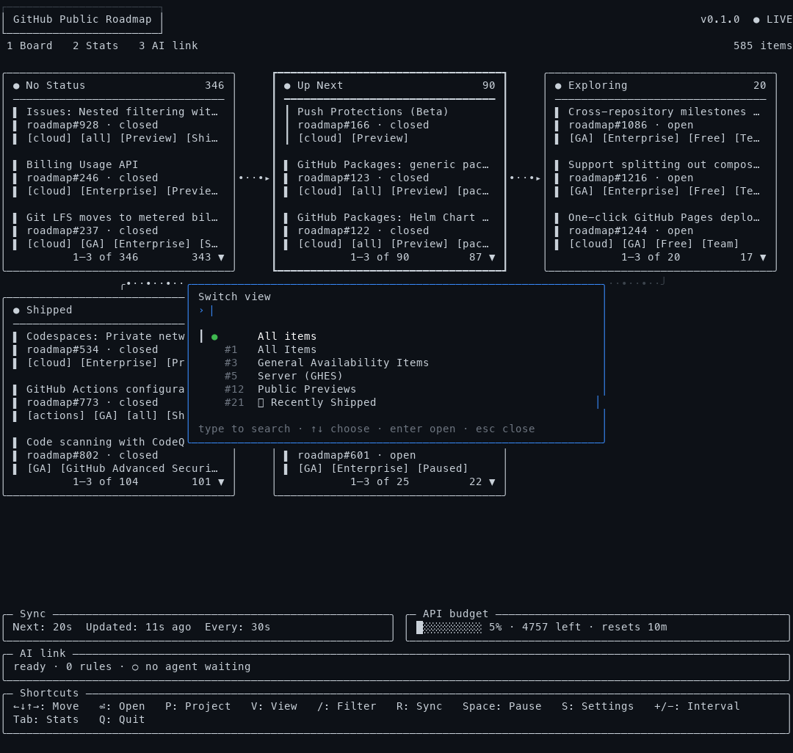
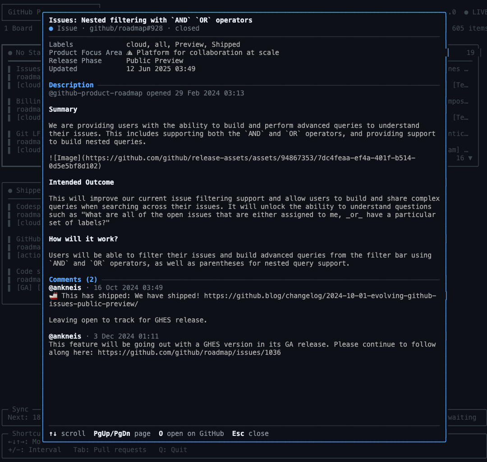
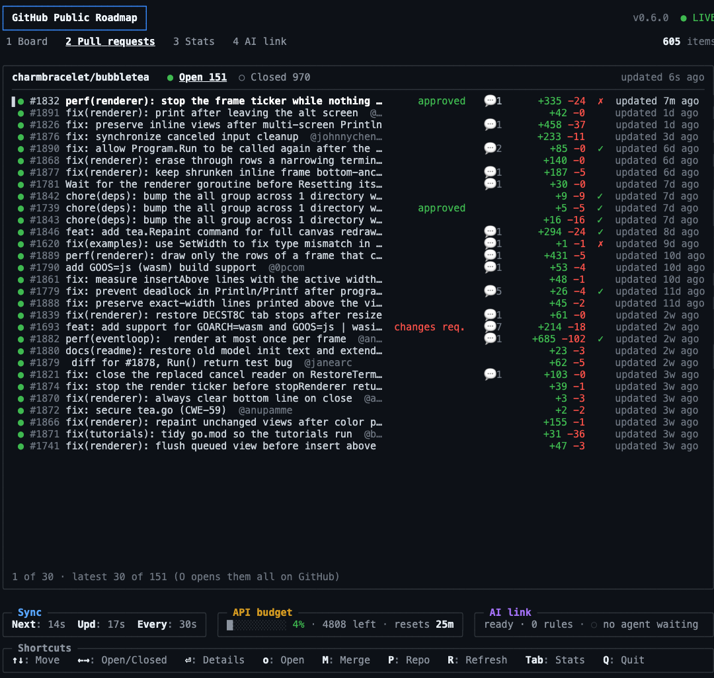
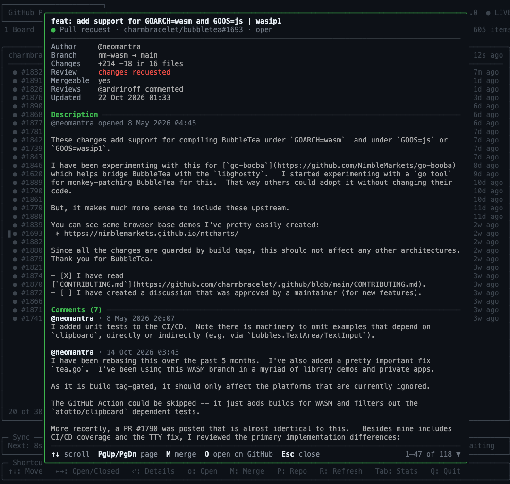
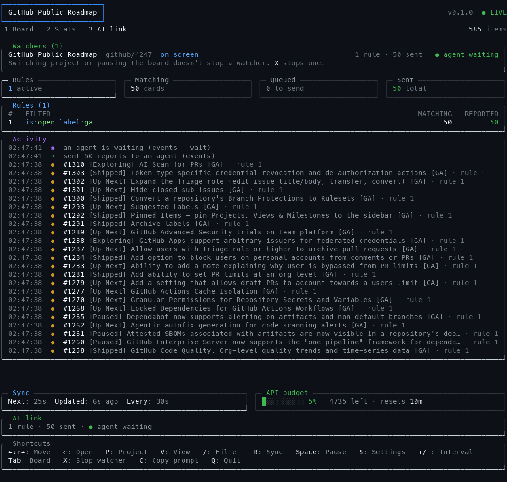

# CardHub

A live terminal dashboard for **GitHub Projects** boards. CardHub shows your board as kanban columns (or a table, for table views), keeps it in sync with GitHub, shows cards moving through your workflow, lists and merges the pull requests of the repos you work on, and can tell AI agents when cards change.



**Why:** my team tracks QA bugs on a GitHub Projects board. I wanted that board live in my terminal instead of a browser tab, and I wanted my AI agents to start on a bug the moment QA files it, instead of polling GitHub every 30 minutes and spending tokens on "nothing changed". CardHub does both: it's the board I keep open, and the watcher my agents wait on. Close it and the automation stops too.

## Features

- **Live board.** Columns follow your project's Status (or a view's grouping) in a grid that wraps to fit any terminal 30+ columns wide. Dotted connectors show the workflow; when a card changes column, a white dot streams along the connectors it crossed, and recently changed cards get a yellow ●.
- **Table views as tables.** A view with the table layout shows its columns as on GitHub. On a narrow terminal the right-hand columns are hidden first; Title (shortened), Status and iteration fields (like a release plan) always stay.
- **Projects and saved views.** `P` and `V` open searchable menus. A view hides the columns its filter leaves out, like on GitHub. CardHub reopens the last board and view you watched.
- **Two boards at once.** `\` opens a second board: another project, or the same one in another view, side by side or stacked.
- **Search with GitHub filters, plus OR.** `/` takes free text or GitHub's filter syntax (`label:bug assignee:@me is:open`) and runs on GitHub, so totals stay exact. It also takes `OR` (or `|`), which GitHub lacks: `assignee:@me OR no:assignee` (up to 3 sides). Each view remembers its own search, also across restarts.
- **Card details.** `⏎` opens a card in a scrollable popup: its fields, description and latest comments, without leaving the terminal.
- **Pull requests.** Screen `2` lists a repo's open or closed pull requests, shows one in full and merges it. The repo menu recommends the repos of the project on your board. See [Pull requests](#pull-requests).
- **A native panel in Herdr.** In [Herdr](https://herdr.dev)'s side panel CardHub is a GUI: columns of cards, card and pull request details, merging, and the project, view and repo menus, all clickable. Everywhere else it stays the terminal app. See [In Herdr's side panel](#in-herdrs-side-panel).
- **Stats.** How many cards moved between columns this session, per project and route (`In Progress → Done`), plus the latest moves.
- **AI link.** Agents (Claude Code or any agent that runs commands) ask CardHub to report card changes, then wait without polling. One CardHub serves several agents on several projects.
- **Gentle on the API.** Loads only the cards on screen (about 1 point per refresh), adapts its refresh rate to your hourly budget, and shows that budget live.

## Install

Download the archive for your system from [Releases](https://github.com/DXMHXR/cardhub/releases/latest) and put `cardhub` on your PATH, or with **Go 1.24+**:

```sh
go install github.com/DXMHXR/cardhub@latest     # or, from a clone: make install
```

If `cardhub` isn't found afterwards, add Go's bin folder to your PATH: `export PATH="$PATH:$(go env GOPATH)/bin"`. On macOS, allow a downloaded binary with `xattr -d com.apple.quarantine <path>/cardhub`.

**Updating:** when a release is out the header shows `↑ vX.Y.Z`. Press `U` or run `cardhub update`: it downloads the release, checks it against `checksums.txt` and replaces itself. A build from source only shows the notice: `git pull && make build`.

<details>
<summary>Install with an AI agent</summary>

Paste this into Claude Code or any coding agent that can run commands:

```text
Install CardHub (https://github.com/DXMHXR/cardhub), a terminal dashboard for GitHub Projects boards, on this machine:

1. If Go 1.24 or newer is installed (`go version`), run `go install github.com/DXMHXR/cardhub@latest`.
   Otherwise download the archive for this OS and CPU from https://github.com/DXMHXR/cardhub/releases/latest,
   check it against checksums.txt, and unpack the `cardhub` binary.
2. Put `cardhub` in a folder that's already on my PATH (prefer ~/.local/bin if it's on PATH; set GOBIN for go install).
   Only if none is suitable, add Go's bin folder to PATH in my shell config, and tell me what you changed.
   On macOS, if a downloaded binary is blocked, remove the quarantine flag with xattr.
3. Make sure GitHub access works: if the GitHub CLI is installed, run
   `gh auth status` and, if the read:project or repo scope is missing, ask me before running
   `gh auth refresh --scopes read:project,repo`. Never print or store my token.
4. Run `cardhub version` and `cardhub doctor`, fix anything doctor marks with ✘ (asking me before changing my
   GitHub login).
5. Run `cardhub skill install` so AI agents on this machine know how to use CardHub, and finish by telling me
   the installed version and how to start it: `cardhub`.
```

</details>

## Quick start

```sh
gh auth login --scopes read:project,repo   # 1. sign in to GitHub (once)
cardhub doctor                             # 2. check everything is ready
cardhub                                    # 3. pick a project and go
cardhub skill install                      # 4. optional: teach your AI agents to use it
```

CardHub takes its token from `GITHUB_TOKEN`, then `GH_TOKEN`, then `gh auth token`. It needs these scopes:

| Scope | Needed for |
|---|---|
| `read:project` | reading boards (required) |
| `repo` | card titles in private repositories (else "(no access)"), pull requests of private repos, merging |
| `read:org` | your organizations' projects in the `P` menu |

A fine-grained token needs Organization → *Projects: Read* and Repository → *Issues*, *Pull requests*, *Metadata: Read* (to merge: *Pull requests* and *Contents: Read and write*). `cardhub doctor` checks all of this and prints the command that fixes anything missing.

## Usage

```sh
cardhub                                              # last board, or pick one from a list
cardhub "Roadmap"                                    # by project name (a unique part works)
cardhub https://github.com/orgs/my-org/projects/3   # by URL (…/views/6 opens that view)
cardhub -view Bug my-org 3                           # by owner and number, in a saved view
cardhub -once my-org 3                               # print column counts and exit
cardhub doctor | version | update                    # check setup · version · install the latest release
```

`-interval 30s` sets the fastest refresh rate.

| Key | Action |
|---|---|
| `←↓↑→` / `hjkl` | move between columns and cards, or table rows |
| `⏎` | card details (see below) |
| `o` | open the selected card on GitHub (`O` opens the board) |
| `P` / `V` | switch project / saved view |
| `/` | search (`esc` clears) |
| `\` · `W` · `B` | split screen · move to the other board · swap their places |
| `R` · `Space` · `+`/`-` | refresh now · pause or resume · refresh faster/slower |
| `Tab` / `1` `2` `3` `4` | Board, Pull requests, Stats and AI link screens |
| `X` / `C` | AI link screen: stop a watcher / copy the sample prompt |
| `U` · `Q` | install the new release · quit (`Ctrl+C` quits at once) |



### Card details

`⏎` on a card (on a board or in a table) opens it in a popup over the board:

- **Fields:** assignees, labels, every project field (Status, iteration…), milestone, parent issue, sub-issue progress and when it was last updated.
- **Description:** loaded from GitHub when the popup opens, with issue-template comments left out and headings in bold.
- **Comments:** the latest 20, each with author and date ("latest 20 of 31" when there are more).

| Key | Action |
|---|---|
| `↑↓` / `jk` | scroll a line |
| `PgUp`/`PgDn` · `Space`/`b` | scroll a page |
| `g` / `G` | top / bottom |
| `o` | open the card on GitHub |
| `Esc` · `q` · `⏎` | close |

Images in a description show as their markdown or HTML for now; `o` opens the card to see them.



## Pull requests

Screen `2` (or `Tab` from the board) shows one repo's pull requests, most recently updated first.



- **Pick a repo with `P`.** The menu starts with the repos of the project on your board, marked ★: first those of the cards on screen, then the rest of the project's (from its cards and the repos linked to it). After them come your 100 most recently pushed repos. Type to narrow the list, or type `owner/name` in full to open any repo. Each project remembers its own repo, also across restarts: switching the board to another project switches the screen to that project's repo, and a project's first visit asks for one.
- **Open or closed with `←→`** (or `S`). Each tab shows its total; closed includes merged. The screen loads the latest 30 and refreshes on the board's cadence; `R` refreshes now and `O` opens the repo's pull requests on GitHub.
- **Each row** shows its state (● open, ◌ draft, ◆ merged, ✕ closed), number, title and author, then the review decision, comment count, lines added and removed, CI status (✓ ✗ ◷) and age.
- **`⏎` shows a pull request** in the same popup as a card: author, `head → base` branch, size (`+120 −30 in 4 files`), review decision and each reviewer's latest review, whether it merges cleanly, CI, then the description and latest comments. Code changes stay on GitHub (`o`).
- **`M` merges it**, from the list or the popup. Choose *Create a merge commit*, *Squash and merge* or *Rebase and merge* (only those the repo allows) and press `⏎`. The dialog warns about conflicts, missing or blocking reviews and failing checks first, and refuses drafts, closed pull requests and repos you can't write to. Branch protection still applies: if GitHub refuses, the dialog shows why.

| Key | Action |
|---|---|
| `↑↓` / `jk` · `g`/`G` · `PgUp`/`PgDn` | move |
| `←→` / `S` | open / closed |
| `⏎` · `o` · `O` | details · open on GitHub · the repo's pull requests on GitHub |
| `M` | merge |
| `P` · `R` | switch repo · refresh |



## In Herdr's side panel

In the [Herdr](https://herdr.dev) app, CardHub's side panel is a native GUI rather than a terminal: the board laid out as in the terminal (a grid of column boxes that wraps to the panel's width, with the moving connectors) with cards you click, the card and pull request details with their markdown rendered, merging with a method picker and a confirm step, an Issues screen (the open or closed issues of the Pull requests screen's repo, each opening with its description and comments), the AI link screen (watchers, rules, activity, the sample prompt to copy, and stopping a watcher), menus for the project, the view and the repo, and the terminal's footer: Sync (with the refresh interval's − / + and Pause, and a red alert once the API budget is nearly used up) and AI link. The search box takes the same filters as `/` and completes them as you type, the way GitHub's filter bar does: qualifiers first (`la` → `label:`), then their values (the project's fields and options, and the labels, people, repos and milestones seen on its cards), with ↑ ↓ to choose, Tab or Enter to pick and Esc to close.

Details show pictures attached on GitHub (in the description and the comments) where they stand; other pictures, such as Google Drive links, stay links. `cardhub -gui` downloads them to `gui/images/`, keeping a picture for 7 days after it was last opened and at most 200 MB in all.

It is the same CardHub underneath: `cardhub -gui` runs in a terminal Herdr keeps hidden and does the syncing, the AI link and the merging. It writes what the panel shows to `gui/state.json` in CardHub's config folder (`~/Library/Application Support/cardhub` on macOS) and takes the panel's clicks from `gui/commands/`. Run anywhere else, CardHub is the terminal app as before; the panel has no switch back to it.

To set it up:

1. Install the panel (the `cardhub` Herdr mod): `herdr/install.sh`. Run it again after updating CardHub.
2. Show the mod in a panel of your layout: a block with `"content": { "mod": "cardhub" }`. It starts `cardhub -gui` in a hidden terminal named `cardhub` (replacing a plain `cardhub` running there), and starts it again if it quits.

The panel opens on the board you watched last.

## AI link: let AI agents react to card changes

An agent asks the CardHub you have open to report specific changes, then waits, using no tokens until something happens.

```sh
cardhub notify add 'is:open label:bug' --board "Roadmap"   # report cards matching this filter
cardhub events --wait --json --board "Roadmap"             # block until there are reports
cardhub notify list                                        # rules, match counts, waiting agent
cardhub notify remove 2                                    # stop rule 2
cardhub guide                                              # the full manual agents read
```

- A rule takes any GitHub project filter (`label:needs-triage`, `status:"Ready for Test"`, `assignee:@me`, `iteration:@current`…). It fires when a card *starts* matching, once per card; cards that already match are reported straight away.
- `events --wait` prints the reports and exits (`--json`: one card per line with `number`, `title`, `status`, `labels`, `url`, `rule`). Reports wait in a queue while no agent listens.
- If CardHub isn't open, `notify add` opens it in a new cmux tab, tmux window or terminal window (`CARDHUB_TERMINAL='<cmd> {cmd}'` picks another; `--no-open` doesn't).
- Each project has one *watcher*; they keep running when you switch boards or pause, and stop when CardHub quits (waiting agents are told). `--board` can be left out while only one project is watched. Only the first CardHub open on a project has its AI link; a second shows **⚠ AI LINK ELSEWHERE**.
- Exit codes: `0` ok · `1` error · `2` usage · `3` watcher stopped · `4` CardHub isn't open.



**Teach your agents once:** `cardhub skill install` adds a small skill to Claude Code, Codex, opencode, Cursor and `~/.agents/skills`. It tells the agent to read `cardhub guide`, which always matches the installed version. Then just say:

> Use cardhub to watch the Roadmap project for cards labelled needs-triage, and triage each one as it comes in.

Without the skill, add ``Before using CardHub, run `cardhub guide`.`` to the agent's instructions.

## API cost

GitHub doesn't push board updates, so CardHub polls GraphQL; a token gets 5,000 points an hour, shared with other tools. One request covers every column with its visible cards and exact total (about 1 point; a search with `OR` costs 3–4). Scrolling loads more, up to 100 cards per column. CardHub uses at most ~15% of the hourly budget and half of what's left before the reset, slowing down as needed (`Every: 1m0s (auto)`). AI link rules cost about 1 point per watched project per check. The Pull requests screen costs about 1 point per refresh while it's on screen, and card details 1 point each time the popup opens. CardHub never changes cards; the only thing it writes is a merge you confirm.

## Troubleshooting

| Message | Fix |
|---|---|
| `no GitHub token found` | `gh auth login --scopes read:project,repo`, or set `GITHUB_TOKEN` |
| `token … expired or revoked` | `gh auth login` again, or create a new token |
| `missing the read:project scope` | `gh auth refresh --scopes read:project,repo` |
| `project … not found` | check the owner and number in the URL, and that you can open it on GitHub |
| cards show `(no access)` | `gh auth refresh --scopes repo` |
| an org's projects are missing under `P` | add `read:org`, or open the board by URL |
| PR list says `HTTP 502` | GitHub timed out on a busy repo; `R` tries again |
| merge fails with a branch-protection message | the repo needs approvals or passing checks first; merge on GitHub if you may bypass them |
| `CardHub isn't open` (exit 4) | open the board, or let `cardhub notify add` open it |

## License

MIT. See [LICENSE](LICENSE).
