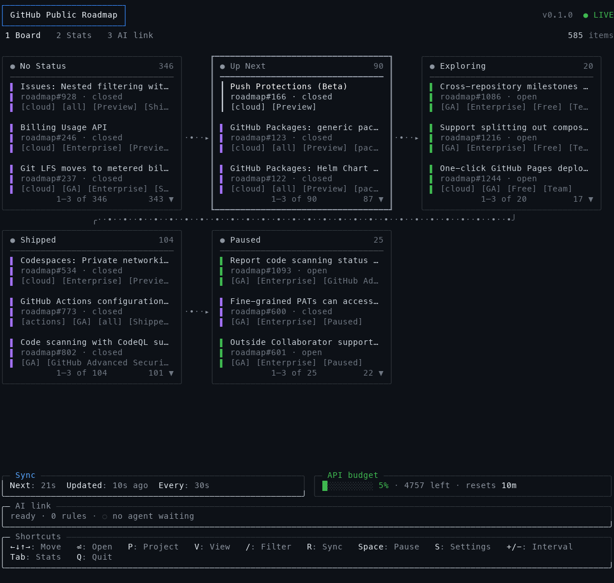
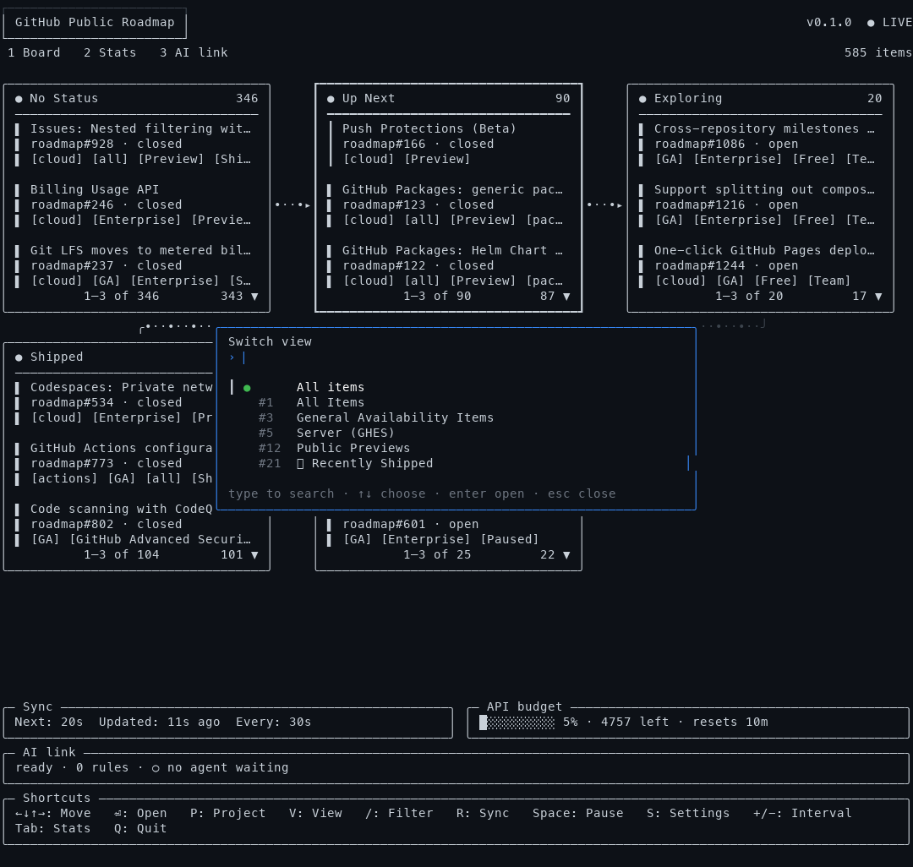
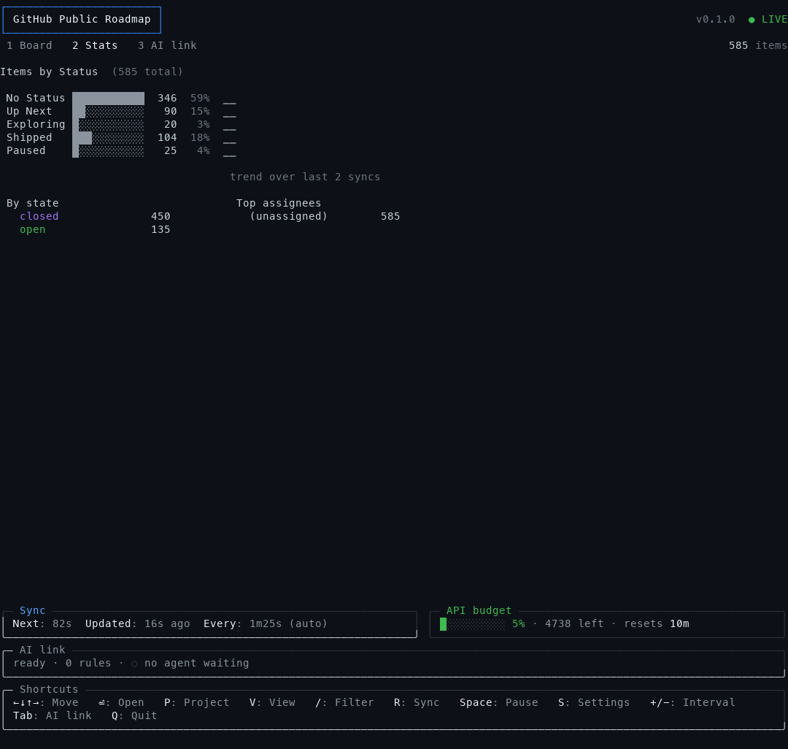
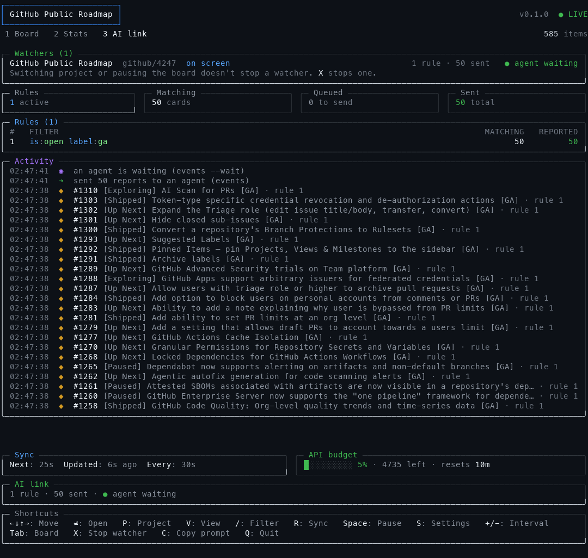
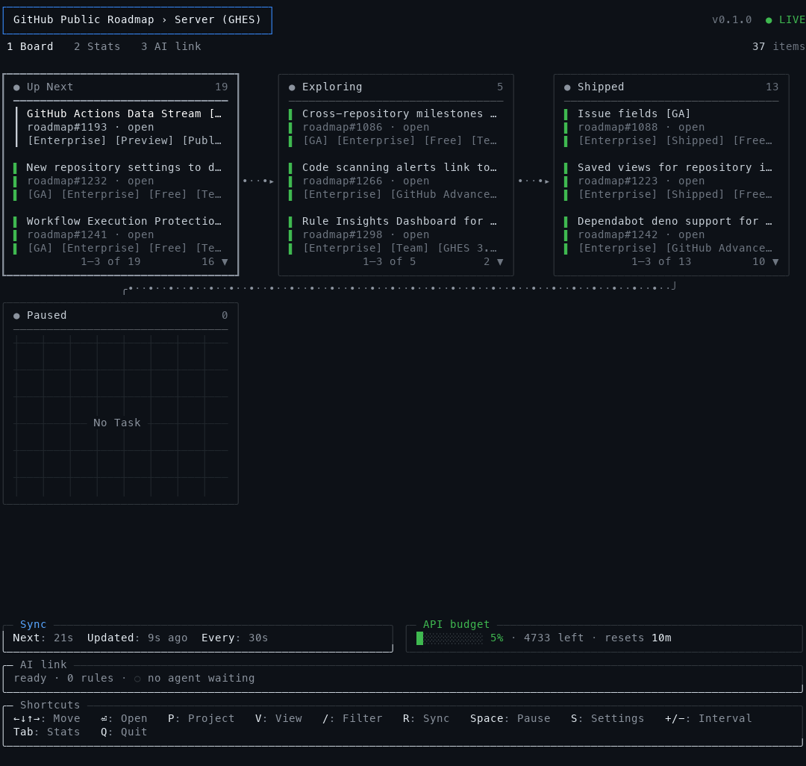
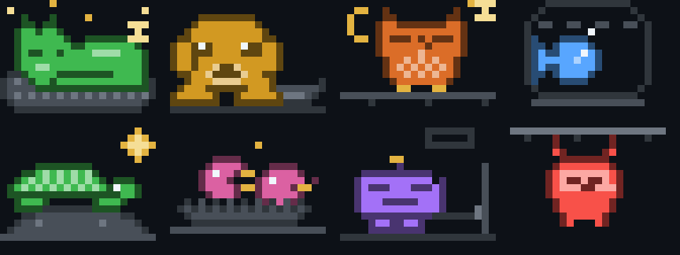

# CardHub

A live terminal dashboard for **GitHub Projects** boards. CardHub shows your board as kanban columns, keeps it in sync with GitHub, animates cards as they move through your workflow, and can tell AI agents when cards change.



## Why I built this

My team tracks QA bugs on a GitHub Projects board. Two things kept bothering me.

**I wanted to watch the board without living in a browser tab.** I spend my day in the terminal, so I wanted the board right there: always up to date, showing at a glance what's waiting, what's in progress and what just moved, without reloading a web page.

**I wanted AI agents to start working the moment QA files a ticket.** I run an AI agent as an orchestrator: when QA reports a new bug, it hands the ticket to a second agent to triage it, then to implement the fix, then pushes the commit. As the work moves along, the card moves through the board's columns, from in progress to waiting for deploy to ready for test. The weak spot was the trigger. The orchestrator checked for new tickets on a timer every 30 minutes. A new bug could wait half an hour before anyone looked at it, and every check woke the model only to find nothing new, spending tokens on "nothing changed".

CardHub fixes both. It's the board I keep open in a terminal tab, and it's also the watcher my agents listen to. The orchestrator tells CardHub what to look for ("new bugs from QA") and waits for free. CardHub, which is refreshing the board anyway, wakes it within seconds when a matching card appears. When I close CardHub the automation stops too, so I'm always in control. Meanwhile I can watch the agents' work move across the board as it happens.

## Features

- **Live kanban board.** Columns follow your project's Status (or a view's grouping) in a responsive grid that wraps to fit any terminal 30+ columns wide. Each column shows 3 cards and scrolls.
- **See work move.** Animated dotted connectors show the workflow direction. When a card changes column, a white dot streams along each connector it crossed, in the direction it moved (`◂` when it went back), until you quit or switch project or view. Recently changed cards get a yellow ●.
- **Projects and saved views.** Switch project (`P`) or saved view (`V`) from a searchable menu. Open a board by its name, URL or owner/number. CardHub remembers the last board and view you watched.
- **Search with GitHub filters.** `/` accepts free text or GitHub's filter syntax (`label:bug assignee:@me is:open`), and runs on GitHub, so column totals stay exact.
- **Stats screen.** A bar and trend line per column, plus breakdowns by state and assignee.
- **AI link.** AI agents (Claude Code or any agent that can run commands) ask CardHub to report specific card changes, then wait without polling. One CardHub can serve several agents on several projects at once. `cardhub skill install` teaches Claude Code, Codex, opencode, Cursor and other agent CLIs how to use it.
- **Gentle on the GitHub API.** It loads only the cards on screen (about 1 point per refresh, whatever the board's size), adjusts its refresh rate to your hourly budget, and shows that budget as a live bar. `Space` pauses refreshing.
- **Empty columns, your way.** "No Task" on a quiet grid by default, or little Game Boy-style pets that doze, laze or wait for food, and jump awake when the cursor lands on their column.
- **Easy setup.** `cardhub doctor` checks your token and access and tells you exactly how to fix anything missing. Errors explain the fix too.

## Install

Requires **Go 1.24 or newer** (`go version`; get it from https://go.dev/dl or `brew install go`).

```sh
go install github.com/DXMHXR/cardhub@latest
```

Or from a clone of this repo:

```sh
git clone https://github.com/DXMHXR/cardhub && cd cardhub
make install          # same as: go install .
```

Either way, this puts the `cardhub` command in Go's bin folder, usually `~/go/bin`. If `cardhub` isn't found afterwards, add that folder to your PATH in `~/.zshrc` or `~/.bashrc` (`make install` prints the line for you):

```sh
export PATH="$PATH:$(go env GOPATH)/bin"
```

Other `make` targets: `make build` (build `./cardhub` here), `make test`, `make uninstall`.

### Install with an AI agent

Paste this into Claude Code (or any coding agent that can run commands) and it will do the whole setup for you:

```text
Install CardHub (https://github.com/DXMHXR/cardhub), a terminal dashboard for GitHub Projects boards, on this machine:

1. If Go 1.24 or newer is installed (`go version`), run `go install github.com/DXMHXR/cardhub@latest`.
   Otherwise download the archive for this OS and CPU from https://github.com/DXMHXR/cardhub/releases/latest,
   check it against checksums.txt, and unpack the `cardhub` binary.
2. Put `cardhub` in a folder that's already on my PATH (prefer ~/.local/bin if it's on PATH; set GOBIN for go install).
   Only if none is suitable, add Go's bin folder to PATH in my shell config, and tell me what you changed.
   On macOS, if a downloaded binary is blocked, remove the quarantine flag with xattr.
3. Make sure GitHub access works: if the GitHub CLI is installed, run
   `gh auth status` and, if the read:project or repo scope is missing, ask me before running
   `gh auth refresh --scopes read:project,repo`. Never print or store my token.
4. Run `cardhub version` and `cardhub doctor`, fix anything doctor marks with ✘ (asking me before changing my
   GitHub login).
5. Run `cardhub skill install` so AI agents on this machine know how to use CardHub, and finish by telling me
   the installed version and how to start it: `cardhub`.
```

## Quick start

```sh
gh auth login --scopes read:project,repo   # 1. sign in to GitHub (once)
cardhub doctor                             # 2. check everything is ready
cardhub                                    # 3. pick a project and go
```

After the first run, `cardhub` reopens the board and view you last watched.

## Sign in to GitHub

CardHub looks for a token in this order and uses the first one it finds:

1. the `GITHUB_TOKEN` environment variable
2. the `GH_TOKEN` environment variable
3. your GitHub CLI login (`gh auth token`). The [GitHub CLI](https://cli.github.com) is optional and only used for this.

The token needs these permissions:

| Scope | Needed for | Without it |
|---|---|---|
| `read:project` (or `project`) | reading boards, columns and views | CardHub can't run |
| `repo` | titles of cards in **private** repositories | those cards show as "(no access)" |
| `read:org` | listing your organizations' projects in the `P` menu | org projects may be missing from the menu (opening them by URL still works) |

**With the GitHub CLI (easiest):**

```sh
gh auth login --scopes read:project,repo        # new login
gh auth refresh --scopes read:project,repo      # already logged in: add the scopes
```

**With a personal access token:**

- *Classic token:* create one at https://github.com/settings/tokens with `read:project`, `repo` and `read:org`.
- *Fine-grained token:* grant Organization → *Projects: Read*, and Repository → *Issues*, *Pull requests* and *Metadata: Read*. Your organization may need to approve fine-grained tokens first.

```sh
export GITHUB_TOKEN=<your token>     # add to ~/.zshrc to keep it
```

### Check your setup

```
CardHub doctor v0.2.1 — checking what CardHub needs to run

 ✔ GitHub CLI installed
 ✔ GitHub token found          from gh auth token
 ✔ Signed in as octocat         API budget 4746/5000 left, resets in 21m
 ✔ Can read projects
 ✔ Can read private repositories
 ✔ 6 open projects you can watch

 ✔ Ready. Run `cardhub` to pick a project, or `cardhub <project-url>`.
```

Anything missing is marked ✘ or !, with the exact command that fixes it.

## Usage

```sh
cardhub                                              # last board, or pick one from a list
cardhub "Roadmap"                                    # open a board by its project name
cardhub https://github.com/orgs/my-org/projects/3   # …by its URL
cardhub my-org 3                                     # …by owner and number
cardhub -view Bug my-org 3                           # open a saved view (name or number)
cardhub https://github.com/orgs/my-org/projects/3/views/6
cardhub -once my-org 3                               # print column counts and exit
cardhub doctor                                       # check your setup
cardhub version                                      # print the version
cardhub notify … / cardhub events …                  # AI link (see below)
cardhub guide                                        # the AI link manual agents read
cardhub skill install                                # teach your AI agent CLIs to use CardHub
```

A board can be named by its **project title** (case doesn't matter, and a unique part such as `road` works), by its URL (the board's address in your browser), or by owner and number. If a name matches several projects, CardHub lists them so you can be more specific. `-interval 30s` sets the fastest refresh rate.

### Keys

| Key | Action |
|---|---|
| `←↓↑→` / `hjkl` | move between columns and cards (past a column's end, ↑/↓ moves between grid rows) |
| `⏎` / `o` | open the selected card on GitHub (`O` opens the board) |
| `P` | switch project: a menu of every project you can open, type to search |
| `V` | switch saved view (or "All items") |
| `/` | search: free text or GitHub filters like `label:bug assignee:@me is:open` (`esc` clears) |
| `R` | refresh now |
| `Space` | pause or resume the board's refreshing (asks first). AI watchers keep running |
| `+` / `-` | refresh faster or slower |
| `Tab` / `1` `2` `3` | Board, Stats and AI link screens |
| `S` | settings |
| `X` / `C` | on the AI link screen: stop a watcher / copy the sample agent prompt |
| `Q` | quit (asks first). `Ctrl+C` quits straight away |

## Screens

### Board

Columns sit side by side while they fit and wrap onto new rows when they don't. The selected column has a bold border in its colour, and the selected card a light-grey bar. The header shows the project, view, version and whether CardHub is live, paused or stale. The footer shows when the next refresh is due, the API budget, the AI link and the shortcuts.



The project and view menus open as dialogs over the dimmed board. Type to search, `⏎` to open.

### Stats



Items per column with a share bar and a trend over recent refreshes, plus breakdowns by state and by assignee. This screen loads every card, so it's the only one that costs more than about 1 API point per refresh, and only while it's open.

### AI link



Every watcher (which project is on screen, rules, reports sent and queued, whether an agent is waiting), totals, the rules agents have set with how many cards match each, and one timeline of everything that happened. `X` stops a watcher. Until an agent connects, the screen also shows the commands to run and a sample prompt (`C` copies it).

## Empty columns and settings

Empty columns show **No Task** on a faint grid by default:



Press `S` for **Settings** and turn on **Empty column animations** for a little pixel scene in each empty column instead: a pet with nothing to do, in the column's colour. Each one is startled awake (a jump and a "!") when the cursor lands on its column, and stays awake while it's selected.



A cat asleep in its basket, a puppy dreaming of a bone, an owl dozing under the moon, a fish waiting for food, a turtle sunning itself, chicks begging in their nest, a robot charging up, and a sloth hanging around. Settings are saved in `~/Library/Application Support/cardhub/settings.json` (macOS) or your platform's config folder.

## AI link: let AI agents react to card changes

A running CardHub can tell AI agents when cards change. An agent doesn't run its own polling loop: it asks CardHub to report specific changes and waits, using no model tokens until something happens.

**Watchers are for AI, the screen is for you.** CardHub runs one *watcher* per project that agents use: the project on screen, plus any project an agent asks for. Watchers keep running when you switch projects or pause the board, so you can browse without interrupting an agent. One CardHub can serve several agents at once, for example AI 1 on project A and AI 2 on project B.

```sh
cardhub notify add 'is:open label:bug' --board "Roadmap"   # report cards matching this filter
cardhub events --wait --json --board "Roadmap"             # block until there are reports
```

- **`notify add '<filter>'`** takes any GitHub project filter. Each matching card is reported once, cards that already match are reported straight away, and a card that stops matching and later matches again is reported again. If no watcher runs for that project, the open CardHub starts one. If CardHub isn't running at all, it opens in a new **cmux** tab in the agent's workspace, a new **tmux** window, or a new iTerm2 / Terminal / Ghostty / WezTerm window (on Linux, your terminal emulator). Set `CARDHUB_TERMINAL='<cmd> {cmd}'` to choose another, or pass `--no-open`.
- **`events --wait`** blocks until there are reports, prints them (`--json`: one card per line with `number`, `title`, `status`, `labels`, `url` and the matching `rule`), and exits. Reports that arrive while no agent waits are queued for the next call. `events` without `--wait` returns the queue immediately.
- **`notify list`** shows a watcher's rules, match counts and whether an agent is waiting. **`notify remove <id>`** stops a rule.
- **`--board`** names the project by title, owner/number or URL. You can leave it out while only one project is watched.

Exit codes: `0` ok · `1` error · `2` usage · `3` watcher stopped (CardHub quit or the watcher was stopped) · `4` CardHub isn't open.

**How the right agent gets the message:** CardHub never picks a terminal. The agent session that runs `events --wait` in the background owns that process, and the agent's harness (Claude Code, for one) wakes that session when the command exits. One agent can wait per watcher.

**Stopping watchers:** quitting CardHub stops all of them, and every waiting agent is told. `X` on the AI link screen stops one after asking. Watchers for projects not on screen close by themselves after a minute with no rules and no agent.

**Two CardHubs on one project:** only the first one opened has the AI link; agents always talk to it. A second one shows **⚠ AI LINK ELSEWHERE** in its header and says in the footer which one (by PID) is connected.

Rules are checked on their own timer against the whole project, whatever is on screen: about 1 API point per watched project per check, covering each rule's first 50 matches. CardHub only reads: agents change cards with their own tools (for example `gh project item-edit`).

**Teach your agents once:** `cardhub skill install` adds a small `cardhub` skill to every agent CLI it finds: Claude Code (`~/.claude/skills`), Codex (`~/.codex/skills`), opencode, Cursor and the shared `~/.agents/skills`. The skill only tells the agent when CardHub helps and to run **`cardhub guide`**, which prints the manual for the installed version, so it never goes stale when you upgrade. For an agent without skills, add ``Before using CardHub, run `cardhub guide`.`` to its instructions file (AGENTS.md, GEMINI.md, …). `cardhub skill uninstall` removes it.

**Example agent instructions:**

> Read `cardhub guide`. Run `cardhub notify add 'is:open label:bug' --no-open`, then run `cardhub events --wait --json` in the background. When it returns, handle each reported card, oldest first, then run `events --wait` again. If it exits with code 3 or 4, CardHub was closed: stop and say so.

## How it stays cheap on the GitHub API

GitHub doesn't push live updates for project boards, so CardHub polls its GraphQL API. Every token gets 5,000 points per hour, shared with `gh` and other tools. CardHub keeps its share small:

- **The board loads only what's on screen.** One request covers every column and fetches the visible cards plus a few extra for scrolling, along with each column's exact total: about 1 point per refresh, whatever the board's size. Scrolling further loads more (`loading…` shows briefly), up to the first 100 cards of a column.
- **Only the Stats screen loads every card** (about 3 points per 100 cards), and only while it's open.
- **The refresh rate adjusts itself.** CardHub uses at most ~15% of the hourly budget, and at most half of what's left before it resets. `-interval` (default 30s) and `+`/`-` set the fastest rate; 5 minutes is the slowest. When it has slowed down, the footer shows `Every: 1m0s (auto)`.

Moves are detected even while only some cards are loaded: exactly for cards on screen, and from changes in column totals for the rest. Archived cards are hidden.

## Troubleshooting

| Message | Fix |
|---|---|
| `no GitHub token found` | `gh auth login --scopes read:project,repo`, or set `GITHUB_TOKEN` |
| `GitHub rejected your token … (expired or revoked)` | `gh auth login` again, or create a new token |
| `missing the read:project scope` | `gh auth refresh --scopes read:project,repo` |
| `project … not found` | check the owner and number in the board's URL, and that you can open it on GitHub |
| cards show `(no access)` | add the `repo` scope: `gh auth refresh --scopes repo` |
| an org's projects don't appear under `P` | add the `read:org` scope, or open the board by URL |
| `cardhub: command not found` | add Go's bin folder to your PATH (see Install) |
| `CardHub isn't open` (exit 4) from `events` | open the board (`cardhub "<project name>"`), or let `cardhub notify add` open it |

`cardhub doctor` checks all of these at once.

## License

MIT. See [LICENSE](LICENSE).
